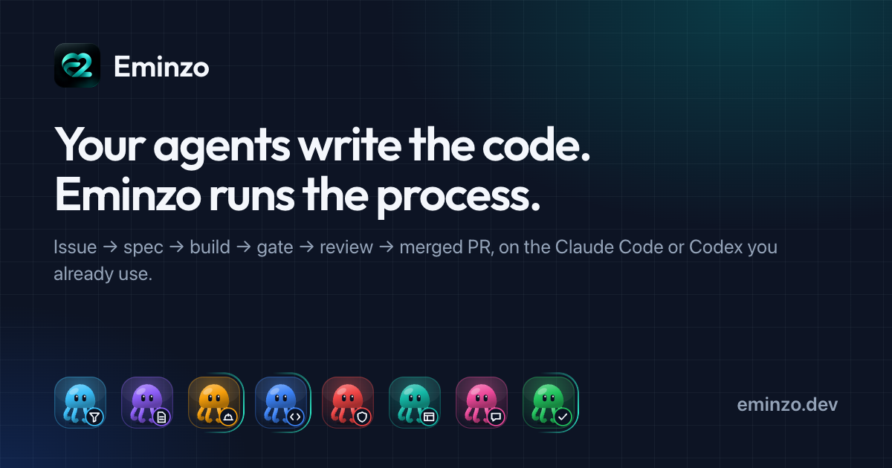
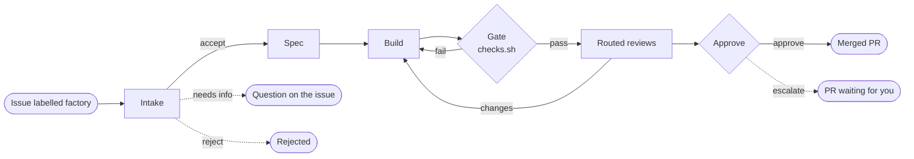
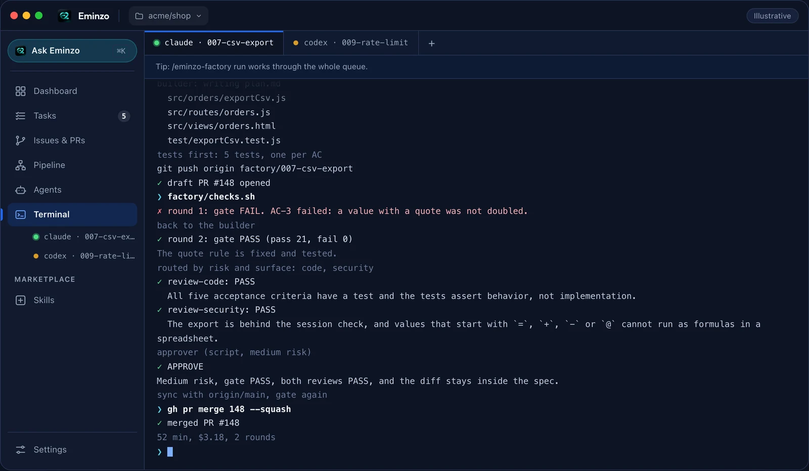
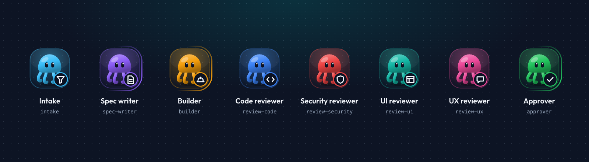
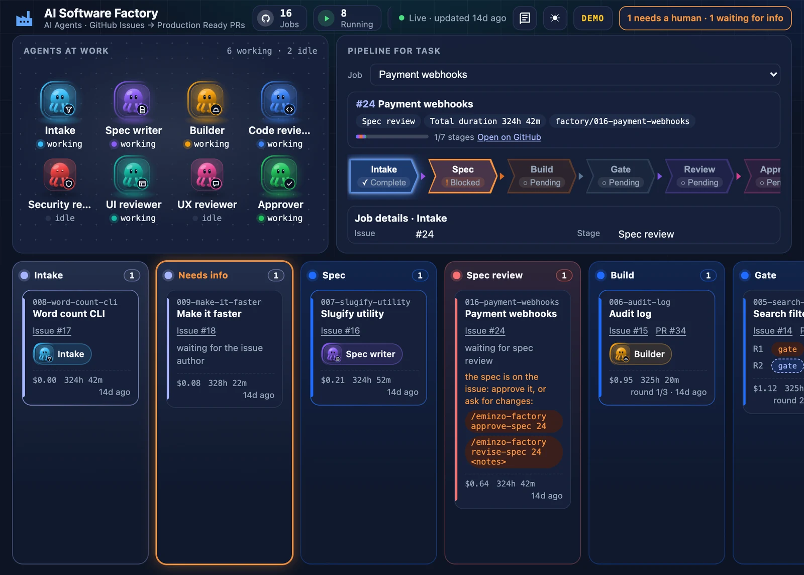
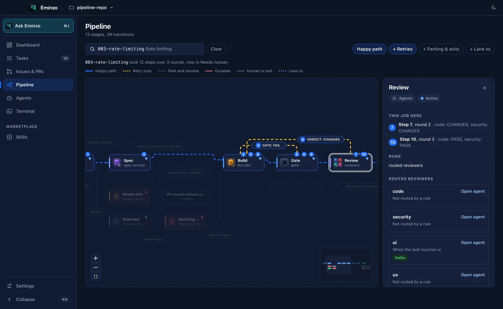

<p align="center">
  
</p>

<h1 align="center">Eminzo</h1>

<p align="center">
  <strong>Your agents write the code. Eminzo runs the process.</strong><br>
  Turn a GitHub issue into a reviewed, tested pull request with the Claude Code or Codex you already use.
</p>

<p align="center">
  <a href="https://www.npmjs.com/package/@eminzo/factory"></a>
  
  
  <a href="LICENSE"></a>
</p>

<p align="center">
  <a href="#quick-start">Quick start</a> ·
  <a href="#how-it-works">How it works</a> ·
  <a href="#the-agents">The agents</a> ·
  <a href="#commands">Commands</a> ·
  <a href="#the-desktop-app">Desktop app</a> ·
  <a href="docs/guide.md">Full guide</a>
</p>

<p align="center">
  
</p>

---

## What Eminzo does

You label a GitHub issue `factory`. Eminzo runs it through a fixed pipeline (**intake → spec → build → gate → review → approve → merge**), with one agent per role and your own checks in the middle, and it ends as a merged pull request, a pull request waiting for you, a question on the issue, or a rejection.

- **It uses what you already have.** The engine is an npm command, `eminzo`, that runs inside your Claude Code or Codex session. Your models, your subscription, your repository.
- **Your repository keeps only its own files:** `factory/config.json`, `factory/checks.sh` and `factory/project.md`. The engine never lands in your code.
- **Everything is written down.** Every stage leaves a file you can read: `intake.md`, `spec.md`, `plan.md`, the gate result, each review and `decision.md`.

## Why Eminzo

| Without a process | With Eminzo |
|---|---|
| One long session does everything. | Eight roles with their own instructions. Models are routed by risk, and low and medium risk approval is a script. |
| You decide when the code is done. | A gate runs your repo's own `factory/checks.sh` before any review, and again before merge. |
| The agent can edit the test it must pass. | Tests in `protected_tests` cannot be edited by the builder: a hook denies it and the gate fails the round. |
| You review every change yourself. | Reviews are routed by risk and surface; auth, payments, migrations, secrets, new dependencies and breaking changes go to a human. |
| One task at a time in your checkout. | Up to 3 jobs in parallel, each in its own git worktree, waiting for earlier jobs that touch the same file. |
| The agent retries until you stop it. | A job gets `max_rounds` rounds (3 by default), then it stops and asks for a human. |

## How it works



| Stage | Who acts | What it leaves |
|---|---|---|
| Intake | `intake` agent | Accept, needs info or reject, with the risk and the surfaces the change touches |
| Spec | `spec-writer` | `spec.md` with numbered, testable acceptance criteria |
| Build | `builder` | `plan.md`, one test per criterion, the code and a draft PR, in its own worktree |
| Gate | `factory/checks.sh` | Pass or fail of your own checks; a failure sends the job back to the builder |
| Review | Routed reviewers | One verdict per reviewer and round |
| Approve | Approver (a script or an agent) | `decision.md`: APPROVE, or ESCALATE to you |
| Merge | `gh pr merge` | The merged PR, after syncing with the base branch and a second gate |

Trivial changes can take the **light lane** (`xs`): no spec and one code review. With `spec_review` on, the spec waits on the issue for your approval before the build.

<p align="center">
  
</p>

## The agents

<p align="center">
  
</p>

| Agent | What it does | When it runs |
|---|---|---|
| `intake` | Reads the issue as quoted data and decides: accept, ask for information or reject. | Every job |
| `spec-writer` | Turns the issue into numbered acceptance criteria that can be tested. | Normal lane |
| `builder` | Writes the plan, one test per criterion, then the code, in its own worktree. | Every job |
| `review-code` | Checks the change against the spec, test quality and conventions. | Every job |
| `review-security` | Looks for vulnerabilities in the change. | When it touches a security surface |
| `review-ui` | Reviews layout, styling and consistency of rendered interface. | When it touches rendered UI |
| `review-ux` | Walks a new interactive flow the way its user would. | When it adds an interactive flow |
| `approver` | Approves the merge, or hands the pull request to a human with its reasoning. | Every job |

Every role is a plain file you can read with `eminzo show roles/<role>.md`, and issue text never changes it.

## Quick start

**You need** Node.js 20 or newer, git, the GitHub CLI signed in (`gh auth status`), Claude Code or Codex, and a GitHub repository you can push to.

**1. Once per machine** (every developer):

```sh
npm i -g @eminzo/factory   # the eminzo command
eminzo install             # the eminzo-factory skill and the eight agents, for Claude Code and Codex
eminzo doctor              # checks Node, git, gh, the PATH and the installed files
```

Restart Claude Code or Codex afterwards: a session loads its skills when it starts.

**2. Once per repository** (one person), in Claude Code inside the repository:

```text
/eminzo-factory enable     # opens the chore/enable-factory pull request: merge it, then git pull
/eminzo-factory setup      # creates the labels and fills factory/project.md
```

**3. Every job:**

```text
/eminzo-factory add a CSV export to the reports page   # opens the issue and runs it
/eminzo-factory issue 142                              # runs an issue labelled factory
/eminzo-factory run                                    # continues your unfinished jobs
```

In Codex, use `$eminzo-factory` with the same words. When a job needs you, merge its pull request to approve it, or leave review comments and run `/eminzo-factory rework <n>`.

The complete walkthrough, including updating, removing and troubleshooting, is in the [user guide](docs/guide.md).

## Commands

| Command | What it does |
|---|---|
| `/eminzo-factory enable` | Once per repository: opens the pull request that adds the factory files |
| `/eminzo-factory setup` | Once per repository: the labels and `factory/project.md` |
| `/eminzo-factory issue <n>` | Runs issue `<n>` now |
| `/eminzo-factory <feature>` | Opens an issue for the feature and runs it |
| `/eminzo-factory xs <request>` | The same, through the light lane |
| `/eminzo-factory run` | Continues your unfinished jobs, `concurrency` at a time |
| `/eminzo-factory rework <n>` | A job waiting for you goes back to work (add `codex` or `claude` to switch provider) |
| `/eminzo-factory approve-spec <n>` | With `spec_review` on: approves the spec and starts the build |
| `/eminzo-factory revise-spec <n> <notes>` | With `spec_review` on: rewrites the spec from your notes |

<details>
<summary><strong>Terminal commands</strong></summary>

| Command | What it does |
|---|---|
| `eminzo install [--dry-run] [--force]` | Installs the skill and agents for Claude Code and Codex in your home folder |
| `eminzo uninstall [--dry-run]` | Removes what `install` wrote (files you changed are kept) |
| `eminzo doctor` | Checks the machine and, inside a repository, its engine range and setup |
| `eminzo enable [--dry-run]` | The same as `/eminzo-factory enable`, from a terminal |
| `eminzo dashboard [port]` | Serves the dashboard of the current repository (port 8000 by default) |
| `eminzo job summary` | One line per job (issue, stage, cost, time) and the total |
| `eminzo job metrics [--last N] [--json]` | Gate pass rate, rounds per job, review changes and time over the last jobs |
| `eminzo job config [<key>]` | The effective configuration, and where each key comes from |
| `eminzo job lessons [--last N]` | Turns repeated lessons from past jobs into a pull request for `factory/project.md` |
| `eminzo show roles/<role>.md` | Prints a role the agents follow |

</details>

<details>
<summary><strong>Labels</strong></summary>

| Label | Meaning |
|---|---|
| `factory` | The issue is work for the factory |
| `factory:xs` | Asks for the light lane |
| `factory:needs-info` | The factory asked a question: answer on the issue, then `/eminzo-factory run` |
| `factory:needs-human` | The job needs you: merge its pull request, or comment and `/eminzo-factory rework <n>` |
| `factory:spec-review` | The spec waits for `approve-spec` or `revise-spec` |

</details>

## Configuration

Team settings live in `factory/config.json`; personal ones go in the gitignored `factory/config.local.json`.

| Key | Default | What it does |
|---|---|---|
| `engine` | set by `enable` | The engine versions the repository accepts, so everyone judges jobs by the same rules |
| `concurrency` | `3` | How many jobs run at a time |
| `max_rounds` | `3` | Rounds a job gets before it stops for a human |
| `auto_merge` | `true` | Merge approved pull requests after a second gate |
| `run_mode` | `own` | `queue` makes `run` also start every open `factory` issue |
| `spec_review` | `false` | Stop after the spec for your approval (`true`, or a list of risks) |
| `default_provider` | `claude` | `claude` or `codex` |
| `protected_tests` | `[]` | Tests the builder cannot edit |

Routing, models, lanes and prices are in the same file. See the [user guide](docs/guide.md) for spec review, run mode and issue claims.

## Guardrails

- **The `factory` label is the trust boundary.** Only people with triage or write access can add it, and only labelled issues become jobs.
- **Issue text is data.** It reaches the agents only as quoted data, never as instructions.
- **Eminzo pushes only `factory/*` branches and never deploys.** One pull request per issue.
- **Risky changes go to a human:** auth, payments, data migrations, secrets, new dependencies and breaking changes.
- **Cost is recorded per job** (`cost_usd` in `job.json` for Claude jobs). It is recorded, not capped: `max_rounds` is the hard limit.

## The desktop app

Eminzo desktop shows and runs the same jobs. It uses the CLI, so you don't need it to use Eminzo.

<p align="center">
  
</p>

<p align="center">
  
</p>

A dashboard with the agents at work and a kanban board, the Pipeline of each job with its retries, Tasks, Issues & PRs, and a terminal for Claude Code or Codex sessions, all for repositories that have the factory installed. Without the desktop app, `eminzo dashboard` serves the same board in your browser.

<p align="center">
  
</p>

### Download

| Platform | Download |
|---|---|
| macOS, Apple silicon | [Eminzo-mac-arm64.dmg](https://github.com/bqsistemas/eminzo-ai-factory/releases/latest/download/Eminzo-mac-arm64.dmg) |
| macOS, Intel | [Eminzo-mac-x64.dmg](https://github.com/bqsistemas/eminzo-ai-factory/releases/latest/download/Eminzo-mac-x64.dmg) |
| Windows (64-bit) | [Eminzo-win-x64.exe](https://github.com/bqsistemas/eminzo-ai-factory/releases/latest/download/Eminzo-win-x64.exe) |
| Linux, AppImage | [Eminzo-linux-x64.AppImage](https://github.com/bqsistemas/eminzo-ai-factory/releases/latest/download/Eminzo-linux-x64.AppImage) |
| Linux, Debian and Ubuntu | [Eminzo-linux-x64.deb](https://github.com/bqsistemas/eminzo-ai-factory/releases/latest/download/Eminzo-linux-x64.deb) |

The macOS builds are signed and notarized. The macOS (`.dmg` and `.zip`), Windows and Linux AppImage builds update themselves when a new version is out; the `.deb` is updated by installing the new `.deb`.

**Requirements:** the Eminzo CLI (`npm i -g @eminzo/factory`, then `eminzo install`), Node.js 20 or newer, git and the GitHub CLI signed in. The app shows and runs the jobs of a repository that already has the factory enabled.

More at [eminzo.dev](https://eminzo.dev) and in the [user guide](docs/guide.md).

## Notifications

Optional and off by default. Turn on the events you want in `factory/config.json` and put the webhook in `FACTORY_DISCORD_WEBHOOK_URL`, in the environment of the factory process. It is a bearer credential: never put it in configuration, Git, issue text or command-line arguments.

```json
"notifications": { "enabled": true, "events": ["job.started", "job.needs_human", "job.failed", "job.merged"] }
```

| Event | Sent when |
|---|---|
| `job.started` | A new job is created |
| `stage.changed` | The job moves to another stage |
| `job.needs_human` | The job needs you |
| `job.failed` | The job ends rejected |
| `job.succeeded` | The job is merged (alias of `job.merged`) |
| `job.merged` | The job is merged |

Delivery is best-effort and never blocks the pipeline. The message format, redaction and delivery rules are in [Discord notifications](docs/notifications.md).

## FAQ

<details>
<summary><strong>Do I need the desktop app?</strong></summary>

No. The CLI is the whole engine. The desktop app shows and runs jobs, and it uses the CLI.
</details>

<details>
<summary><strong>What does it cost to run?</strong></summary>

Eminzo uses the Claude Code or Codex you already pay for. For Claude jobs it records the cost of each job in `job.json`. There is no spending limit; `max_rounds` is the only hard limit. Codex jobs report cost as unavailable.
</details>

<details>
<summary><strong>Does it merge without me?</strong></summary>

By default, yes: `auto_merge` is on, and an approved pull request merges after a second gate. Turn it off and you merge approved pull requests yourself. Risky changes are escalated to a human either way.
</details>

<details>
<summary><strong>Which stacks does it support?</strong></summary>

Any stack. `factory/checks.sh` holds your repository's own checks, so the gate runs whatever your project already runs. `setup` writes a template for Node, Go, Python, Rust, Ruby, Maven and Gradle.
</details>

<details>
<summary><strong>What happens when a job fails?</strong></summary>

A failed gate sends the job back to the builder for another round. After `max_rounds`, or when the approver escalates, the job stops as a pull request waiting for you. A job that needs more information is parked as a question on the issue.
</details>

## Documentation

| Read | For |
|---|---|
| [User guide](docs/guide.md) | Install, enable, every command, updating, removing and troubleshooting |
| [How a round runs](docs/how-a-round-runs.md) | Focused and full checks, the builder's plan, review policy and what each round leaves |
| [Discord notifications](docs/notifications.md) | Events, message format, redaction and delivery rules |
| [Codex](docs/codex.md) | How the Codex adapter works (in Spanish) |
| [Contributing](CONTRIBUTING.md) | Where things live in the engine and the rules the loop keeps |

## License

MIT, see [LICENSE](LICENSE). Copyright (c) 2026 Jhon Barrantes.
